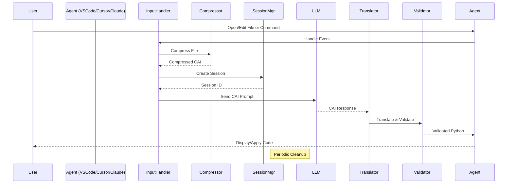

# Optimize AI System Architecture

## Overview

Optimize AI is a modular, extensible system designed for intelligent code compression to enhance LLM interactions in development workflows. By reducing token usage by up to 87% while preserving semantic integrity, it enables more efficient AI-assisted coding across agents like VSCode, Cursor, and Claude. The architecture emphasizes separation of concerns, asynchronous operations for performance, and security in session management. Built in Python with async support (asyncio), it supports MVP scalability with potential for cloud deployment.

Key goals:
- Modular integration with various IDEs and CLIs.
- Multi-tier compression for varying code complexities.
- Reversible translation from CAI (Compressed AI) format back to Python.
- Metrics and validation for quality assurance.

## Components

The system is divided into core, input, output, CLI, and integration layers.

### Core
- **SecureSessionManager**: Manages compression sessions with TTL for expiration, secure storage (in-memory or persistent), and cleanup. Handles creation, retrieval, and metadata.
- **ConfigManager**: Loads configurations from env vars, files, or defaults (e.g., thresholds, tiers).
- **MetricsCollector**: Tracks compression ratios, token savings, durations, and similarities. Supports async recording for non-blocking ops.

### Input Optimizer
- **WaterfallCompressor**: Core engine applying tiered compression (tiny to huge) based on code size/complexity. Uses utils like token counting.
- **Integrations (UnifiedInputHandler)**: Agent-specific handlers (VSCode, Cursor, Claude) for events like file open/change/commands. Compresses input before LLM.

### Output Translator
- **CAIToPythonTranslator**: Reverses CAI to executable Python, handling structures like functions (F[]), classes (C[]).
- **SemanticValidator**: Validates translation fidelity using similarity metrics (e.g., cosine via sentence transformers).

### CLI
- **Main CLI Group**: Commands for compress, translate, session (create/get/list/delete), integrate (install/status/uninstall).
- Built with Click for user-friendly interface, supporting verbose logging and JSON outputs.

### Integrations
- **Agent-Specific Packages**: 
  - VSCode/Cursor: TS extensions for event handling (onOpen/onChange), status bar, commands.
  - Claude: Bash wrapper (claude-cai) intercepting commands, compressing inputs.
- Unified handlers ensure consistent API across agents.

## Data Flow

1. **Input Handling**: Agent triggers event (e.g., file open in VSCode). UnifiedInputHandler routes to agent-specific integration, which compresses via WaterfallCompressor.
2. **Session Management**: Compressed content stored in SecureSessionManager with metadata (e.g., tokens saved).
3. **LLM Interaction**: CAI format sent to LLM (e.g., via prompt in Claude).
4. **Output Processing**: LLM response in CAI translated back via CAIToPythonTranslator.
5. **Validation & Metrics**: Semantic similarity checked; metrics recorded (e.g., reduction %).
6. **Cleanup**: Expired sessions removed periodically.

### Sequence Diagram (Mermaid)

## Extensibility

- **Plugins**: Add new agents via subclassing BaseIntegration.
- **Tiers**: Extend WaterfallCompressor with custom tiers.
- **Validators**: Plug in additional metrics/models.
- **Deployment**: CLI for local; API mode for server (e.g., FastAPI endpoint).

## Security Considerations

- Sessions use secure IDs (UUID) and TTL to prevent leaks.
- No persistent storage in MVP; in-memory only.
- Input validation to avoid injection in compress/translate.

## Performance & Scalability

- Async ops for concurrent handling.
- Caching in metrics (e.g., models).
- For production: Add Redis for sessions, rate limiting.

## Tech Stack

- Python 3.8+ with asyncio.
- Libs: Click (CLI), Sentence Transformers (validation), Tiktoken (tokens).
- Extensions: TypeScript for VSCode/Cursor.
- Testing: Pytest with async support.

For implementation details, see source code. Contact support for custom extensions.